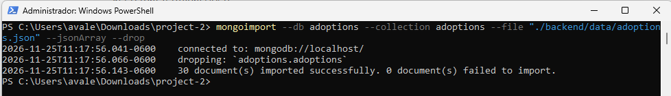
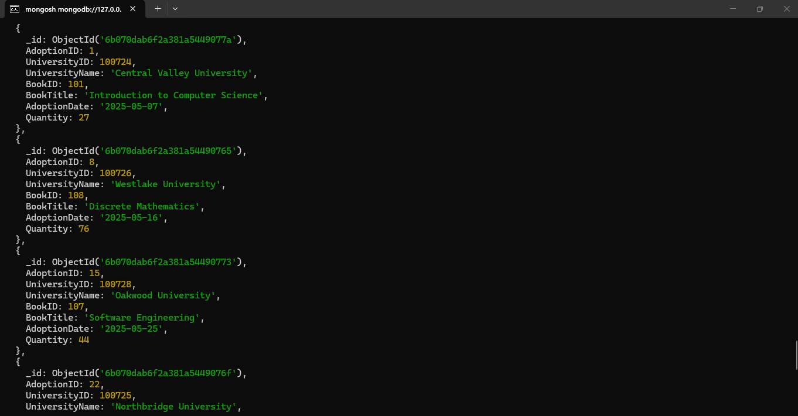
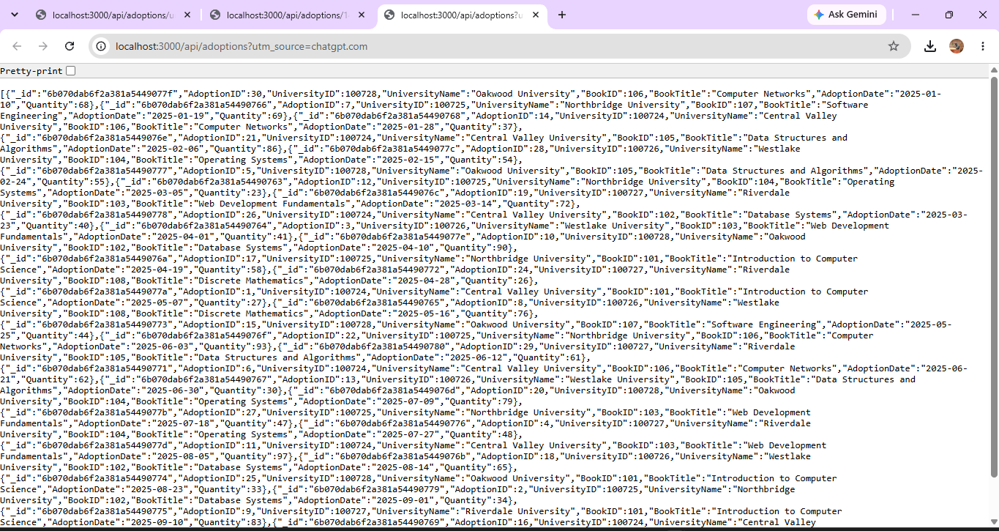
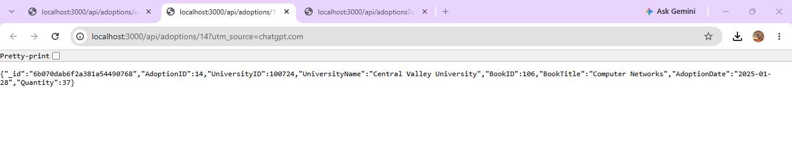
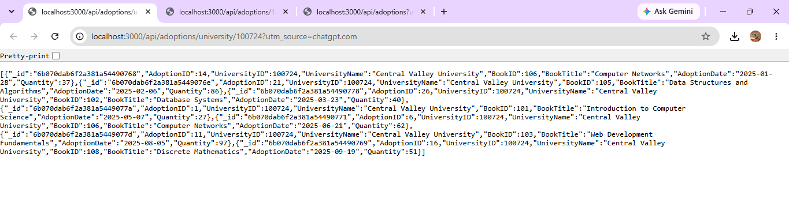
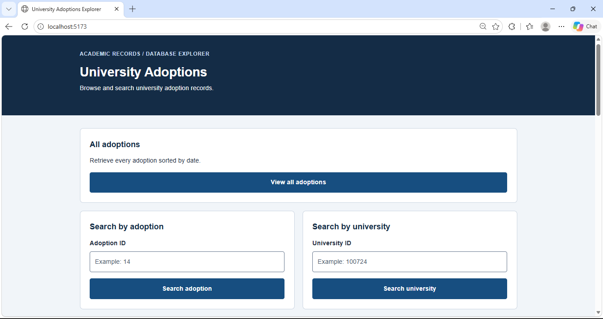
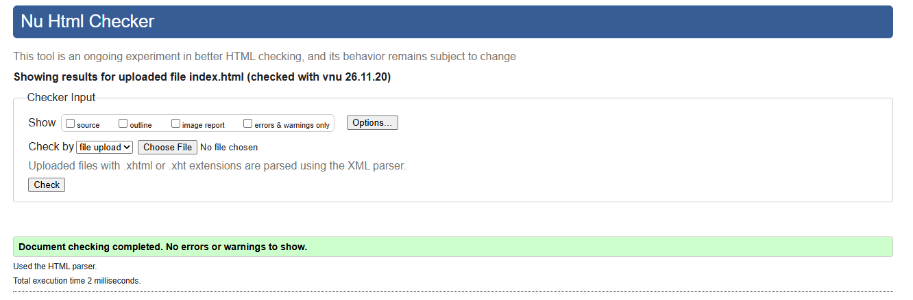
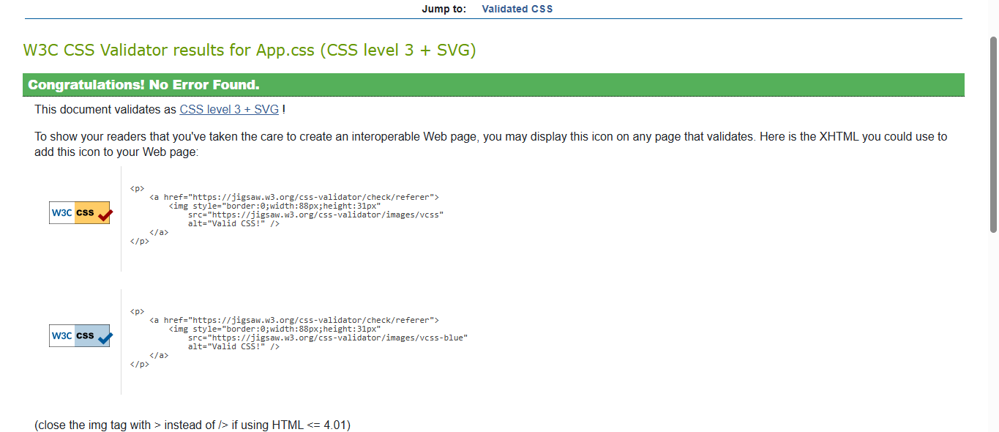
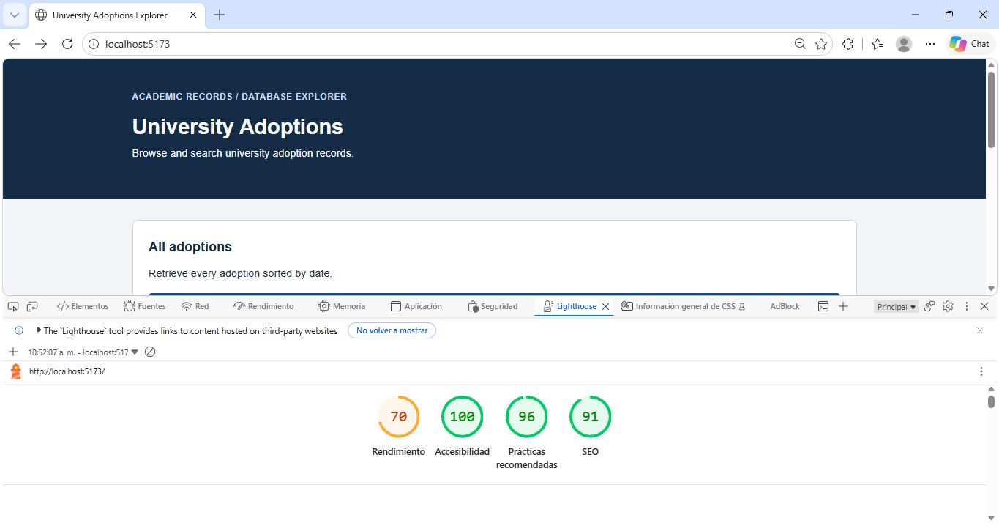

# Project 2
## University Adoptions Explorer
### HTML and CSS Validation Report

**Student:** Valeria Gabriela Astorga Armijo

**Course:** Web Development II

**Date:** November 25th, 2026

---

## 1. Project Overview

The University Adoptions Explorer is a full-stack web application designed to retrieve and display adoption records stored in a MongoDB database. The application uses Node.js and Express for its REST API, React for the frontend, and CSS for responsive and accessible styling.

The application incorporates three API endpoints:

| HTTP Method | Endpoint | Function |
|---|---|---|
| GET | /api/adoptions | Retrieves all adoptions sorted by adoption date. |
| GET | /api/adoptions/:id | Retrieves a single adoption by AdoptionID. |
| GET | /api/adoptions/university/:id | Retrieves all adoptions matching a UniversityID. |

The React frontend uses the JavaScript Fetch API to communicate with these endpoints.

## 2. Database Configuration and Functional Testing

The adoption dataset was imported into MongoDB using the mongoimport utility.

**Database:** adoptions

**Collection:** adoptions

The database queries used to verify the imported records were:

```javascript
db.adoptions.find({ AdoptionID: 14 })
```

```javascript
db.adoptions.find({ UniversityID: 100724 })
```

**Database import evidence**



**Database query evidence**



### 2.1. API Testing

The API endpoints were evaluated by inspecting the JSON responses returned by the Express server.







### 2.2. Frontend Testing

The frontend was evaluated using valid IDs, nonexistent IDs, invalid numeric input, keyboard navigation, and different viewport sizes.



**Functional testing results:** [Summarize actual results.]

## 3. Validation Process Documentation

### 3.1. HTML Validation

The HTML validation process used the W3C Markup Validation Service and the Nu HTML Checker.

The following procedure was followed:

1. Upload the index.html document to the W3C validator.
2. Run the React application.
3. Retrieve the rendered HTML through browser developer tools.
4. Submit the rendered markup to the Nu HTML Checker.
5. Record all errors and warnings.
6. Analyze their root causes.
7. Implement appropriate corrections.
8. Repeat validation to confirm the results.

**Initial validation evidence:**



### 3.2. CSS Validation

The stylesheet was evaluated using the W3C CSS Validation Service.

The following procedure was followed:

1. Open the W3C CSS validator.
2. Select validation by file upload.
3. Upload App.css.
4. Select the appropriate CSS validation profile and warning settings.
5. Review the reported errors and warnings.
6. Correct invalid properties, values, or declarations.
7. Repeat validation using the corrected stylesheet.

**Initial validation evidence:**



## 4. Error Identification and Analysis

The HTML document and CSS stylesheet were evaluated using the official W3C validation services to identify syntax errors, invalid declarations, deprecated elements, and potential structural problems.

The W3C Nu HTML Checker reported zero errors and zero warnings for index.html, while the W3C CSS Validation Service reported zero errors for App.css.

Although no validation errors were reported, several potential implementation issues were identified for preventive analysis. These issues were categorized according to their root cause, potential impact, and corresponding preventive solution.

### 4.1. Issue Classification and Root Cause Analysis

| Potential Issue | Category | Root Cause | Preventive Correction |
|---|---|---|---|
| Missing document language | HTML / Accessibility | Missing lang attribute in the HTML element. | Declared lang="en" in index.html. |
| Incorrect form label association | Accessibility | Label identifier does not match the corresponding input identifier. | Matched htmlFor with the input id. |
| Excessive use of generic containers | Semantic HTML | Lack of meaningful structural elements. | Used header, main, section, and footer elements. |
| Missing viewport configuration | Responsive design | Missing viewport metadata. | Included responsive viewport configuration. |
| Invalid CSS property names | CSS syntax | Incorrect spelling of standardized CSS properties. | Used valid properties such as background-color. |
| Missing CSS measurement units | CSS value validation | Nonzero length values without valid units. | Used appropriate units such as rem and px. |
| Excessive CSS specificity | CSS optimization | Overly specific selectors and unnecessary !important declarations. | Implemented reusable class selectors. |
| Missing keyboard focus indicators | Accessibility | Removal of focus outlines without an alternative. | Implemented visible focus outlines. |
| Nonresponsive layouts | Responsive design | Layouts that do not adapt to different viewport sizes. | Implemented flexible layouts and media queries. |

### 4.2. Validation Findings

| Validation Component | Errors | Warnings | Status |
|---|---|---|---|
| HTML document (index.html) | 0 | 0 | Passed |
| CSS stylesheet (App.css) | 0 | Not confirmed | Passed |

The validation results indicate that the submitted HTML document and CSS stylesheet comply with the syntactic and structural requirements evaluated by the respective validators.

No deprecated HTML elements, invalid CSS properties, or syntax errors were reported in the submitted files.

The potential issues listed in Section 4.1 represent preventive implementation considerations rather than errors reported by the validators. Their corresponding before-and-after code examples and technical explanations are presented in Section 5.

### 4.3. Potential Impact of Identified Issues

If the potential issues described above were present in the application, they could negatively affect:

- Browser compatibility and consistent rendering.
- Screen reader compatibility and accessibility.
- Keyboard navigation and form usability.
- Responsiveness across different devices.
- CSS organization and maintainability.
- Compliance with established web development standards.

Preventive implementation practices were incorporated to minimize these risks and improve the overall quality of the application.

### 4.4. Validation Evidence and Error Log

The official validator messages, validation results, issue classifications, root cause analysis, and preventive corrections are recorded in validation-log.txt.

The corresponding validation screenshots are available in the documentation/screenshots directory.

The preventive examples are distinguished from actual validation findings to ensure the accuracy and transparency of the documentation.

## 5. Corrections and Fix Implementation

During the development of the University Adoptions Explorer, preventive implementation practices were incorporated to ensure compliance with HTML5 and CSS3 standards.

The submitted HTML document and CSS stylesheet successfully passed their respective W3C validation checks without reported errors. Consequently, no additional error-specific corrections were required for these files.

The following before-and-after code examples illustrate common implementation problems and the standards-compliant solutions incorporated into the application. The incorrect examples are illustrative and do not represent errors reported during the documented validation.

### 5.1. HTML Corrections and Preventive Implementation

#### 5.1.1. Document Language Declaration

**Category:** Accessibility and HTML document structure.

**Potential issue:** Missing document language declaration.

**Before — illustrative incorrect implementation:**

```html
<html>
```

**After — implemented code:**

```html
<html lang="en">
```

**Root cause:** Omitting the language attribute prevents assistive technologies from reliably identifying the primary language of the document.

**Correction:** The lang attribute was included in the HTML element to explicitly identify English as the document language.

**Importance:** This supports screen readers, pronunciation accuracy, translation tools, and accessibility standards.

#### 5.1.2. Form Label Association

**Category:** Accessibility and semantic HTML.

**Potential issue:** Incorrect association between a label and its corresponding input.

**Before — illustrative incorrect implementation:**

```jsx
<label htmlFor="id">Adoption ID</label>
<input id="adoption-id" type="number" />
```

**After — implemented approach:**

```jsx
<label htmlFor="adoption-id">
    Adoption ID
</label>

<input
    id="adoption-id"
    name="adoptionId"
    type="number"
    min="1"
    step="1"
    required
/>
```

**Root cause:** The label references an identifier that does not match the input element.

**Correction:** The htmlFor attribute was assigned the same value as the corresponding input identifier.

**Importance:** Correct label association allows assistive technologies to identify the purpose of each input and improves form usability.

#### 5.1.3. Semantic HTML Structure

**Category:** Semantic markup and accessibility.

**Potential issue:** Excessive use of generic containers without meaningful document structure.

**Before — illustrative implementation:**

```jsx
<div className="site-header">
    <h1>University Adoptions</h1>
</div>
```

**After — implemented approach:**

```jsx
<header className="site-header">
    <h1>University Adoptions</h1>
</header>
```

**Root cause:** Generic div elements do not communicate the same structural meaning as semantic HTML elements. Although the original example is syntactically valid, it provides less semantic information.

**Correction:** Semantic elements such as header, main, section, and footer were incorporated into the application.

**Importance:** Semantic markup improves document organization, maintainability, and navigation through assistive technologies.

#### 5.1.4. Responsive Viewport Configuration

**Category:** Responsive design and usability.

**Potential issue:** Missing viewport configuration.

**Before — illustrative implementation:**

```html
<head>
    <meta charset="UTF-8">
    <title>University Adoptions Explorer</title>
</head>
```

**After — implemented approach:**

```html
<head>
    <meta charset="UTF-8">

    <meta name="viewport"
          content="width=device-width, initial-scale=1.0">

    <title>University Adoptions Explorer</title>
</head>
```

**Root cause:** Without viewport configuration, mobile browsers may display the application using an unsuitable layout viewport.

**Correction:** The viewport metadata was included to adapt the application to different screen sizes.

**Importance:** This improves responsiveness and usability across desktop, tablet, and mobile devices.

### 5.2. CSS Corrections and Preventive Implementation

#### 5.2.1. Valid CSS Property Names

**Category:** CSS syntax and property validation.

**Potential issue:** Use of an invalid CSS property name.

**Before — illustrative incorrect implementation:**

```css
button {
    background-colour: #174e80;
}
```

**After — implemented approach:**

```css
button {
    background-color: #174e80;
}
```

**Root cause:** The property background-colour is not recognized by the CSS specification.

**Correction:** The standardized background-color property was used.

**Importance:** Valid CSS properties ensure that browsers can correctly interpret and apply the intended styles.

#### 5.2.2. Valid CSS Measurement Units

**Category:** CSS value validation.

**Potential issue:** Missing measurement units in a nonzero length value.

**Before — illustrative incorrect implementation:**

```css
.panel {
    padding: 20;
}
```

**After — implemented approach:**

```css
.panel {
    padding: 1.5rem;
}
```

**Root cause:** Nonzero CSS padding lengths require valid measurement units.

**Correction:** The rem measurement unit was used to define spacing.

**Importance:** Valid relative units support consistent spacing and allow the interface to adapt to changes in the root font size.

#### 5.2.3. CSS Specificity and Maintainability

**Category:** CSS specificity and code optimization.

**Potential issue:** Unnecessary use of highly specific selectors and important declarations.

**Before — illustrative implementation:**

```css
main section.panel {
    background-color: #ffffff !important;
}
```

**After — implemented approach:**

```css
.panel {
    background-color: #ffffff;
}
```

**Root cause:** Excessively specific selectors and unnecessary important declarations make styles more difficult to override and maintain.

**Correction:** A reusable class selector was used to apply consistent styles to multiple interface sections.

**Importance:** Simplified selectors improve maintainability, reduce unnecessary repetition, and prevent avoidable styling conflicts.

This issue represents a CSS quality consideration rather than a syntax validation error.

#### 5.2.4. Accessible Keyboard Focus

**Category:** Accessibility and usability.

**Potential issue:** Removing keyboard focus indicators.

**Before — illustrative implementation:**

```css
button:focus {
    outline: none;
}
```

**After — implemented code:**

```css
a:focus,
input:focus,
button:focus,
.table-container:focus {
    outline: 3px solid #b45309;
    outline-offset: 3px;
}
```

**Root cause:** Removing the focus outline without providing an alternative makes keyboard navigation difficult.

**Correction:** A visible focus indicator was applied to interactive elements.

**Importance:** Users navigating with a keyboard can identify the currently focused element. This improves accessibility and overall usability.

This improvement addresses accessibility rather than a CSS syntax error.

#### 5.2.5. Responsive CSS Implementation

**Category:** Responsive design and CSS optimization.

**Potential issue:** Using fixed layouts that do not adapt to smaller screens.

**Before — illustrative implementation:**

```css
.search-grid {
    display: flex;
}
```

**After — implemented approach:**

```css
.search-grid {
    display: flex;
    flex-wrap: wrap;
}

@media (max-width: 600px) {
    .search-grid {
        display: block;
        margin: 0;
    }

    .panel {
        padding: 1rem;
    }
}
```

**Root cause:** A layout without appropriate responsive behavior may become difficult to use on smaller screens.

**Correction:** Flexible layouts and media queries were incorporated to adapt the interface to different viewport sizes.

**Importance:** Responsive CSS improves usability across devices and reduces the need for separate desktop and mobile stylesheets.

### 5.3. Final Validation

The HTML document and CSS stylesheet were evaluated using the official W3C validation services on November 25, 2026.

#### 5.3.1. HTML Validation Results

The frontend index.html document was uploaded to the W3C Nu HTML Checker.

**Validator:** W3C Nu HTML Checker

**Validator version:** vnu 26.11.20

**Validation method:** File upload

**Parser:** HTML parser

**Execution time:** 2 milliseconds

**Errors detected:** 0

**Warnings detected:** 0

**Validation status:** PASSED

The validator displayed the following confirmation message:

> Document checking completed. No errors or warnings to show.


*Figure: W3C Nu HTML Checker results confirming that the submitted index.html document contains no reported errors or warnings.*

The results confirm that the submitted HTML document satisfies the structural and syntactic requirements evaluated by the validator.

#### 5.3.2. CSS Validation Results

The App.css stylesheet was uploaded to the W3C CSS Validation Service using the CSS Level 3 + SVG validation profile.

**Validator:** W3C CSS Validation Service

**Validation method:** File upload

**Validation profile:** CSS Level 3 + SVG

**Errors detected:** 0

**Validation status:** PASSED

The validator displayed the following confirmation messages:

> Congratulations! No Error Found.

> This document validates as CSS level 3 + SVG!


*Figure: W3C CSS Validation Service results confirming successful stylesheet validation under the CSS Level 3 + SVG profile.*

The results confirm that the submitted stylesheet contains no reported CSS validation errors.

#### 5.3.3. Validation Results Summary

| Validation Metric | Documented Result | Status |
|---|---|---|
| HTML syntax errors | 0 | Passed |
| HTML warnings | 0 | Passed |
| CSS validation errors | 0 | Passed |
| CSS warnings | Not shown in captured evidence | Not confirmed |
| HTML document structure | Accepted by validator | Passed |
| CSS Level 3 + SVG compliance | Accepted by validator | Passed |

Both submitted files successfully passed their respective validation checks. No additional error-specific corrections were required based on the documented results.

The preventive implementation examples presented in Sections 5.1 and 5.2 demonstrate how common markup, styling, accessibility, and maintainability issues were addressed through appropriate development practices.

#### 5.3.4. Remaining Issues and Limitations

No validation errors remain in the submitted index.html and App.css files according to the captured results.

However, the validation of index.html does not independently verify all HTML elements dynamically generated by React. The rendered application should therefore be validated separately.

Furthermore, HTML and CSS validation do not guarantee complete accessibility, optimal performance, or correct application functionality. These characteristics require complementary functional testing, keyboard navigation testing, responsive design testing, and accessibility auditing.

#### 5.3.5. Final Assessment

The successful validation results demonstrate that the submitted HTML document and CSS stylesheet follow recognized web development standards.

The use of semantic HTML, valid CSS declarations, reusable selectors, responsive layouts, and accessibility-oriented implementation practices contributes to a more organized, maintainable, and user-friendly application.

The W3C validation screenshots provide documented evidence of successful markup and stylesheet validation.

## 6. Importance of HTML and CSS Validation

### 6.1. Browser Compatibility

Valid HTML and CSS reduce inconsistencies in how browsers interpret and render a website. Following standardized markup and stylesheet rules helps the University Adoptions Explorer maintain a consistent structure and presentation across different browsers.

### 6.2. Accessibility

Validation helps identify structural problems that may affect assistive technologies, including invalid markup and incorrect label associations. Semantic elements, language declarations, accessible form labels, visible keyboard focus, and meaningful table headings improve usability for users with disabilities.

Validation is not a substitute for comprehensive accessibility testing, so additional keyboard and Lighthouse checks are necessary.

### 6.3. Performance

Valid, well-organized code reduces unnecessary complexity and makes rendering problems easier to diagnose. Reusable CSS classes, native system fonts, and the absence of unnecessary styling libraries also reduce external dependencies and resource requirements.

Validation alone does not guarantee improved loading performance, but it supports sound development practices.

### 6.4. Maintainability

Standards-compliant code is easier to read, debug, modify, and maintain. Consistent naming conventions, reusable CSS selectors, and semantic HTML help developers understand the application's structure and prevent avoidable implementation errors.

### 6.5. Standards Compliance

Using W3C validation services helps ensure that HTML and CSS follow established web standards. Standards compliance reduces reliance on browser-specific error recovery and supports long-term interoperability.

## 7. Accessibility and CSS Optimization

The frontend incorporates the following accessibility and optimization practices:

- Semantic HTML landmarks.
- A logical heading hierarchy.
- A declared document language.
- Explicitly associated form labels.
- Required fields and numeric input validation.
- Keyboard-accessible native controls.
- Visible focus indicators.
- A skip-to-content link.
- Screen-reader status announcements.
- Accessible error messages.
- Semantic tables with captions and column headings.
- Responsive layouts using media queries.
- High-contrast text and backgrounds.
- Reusable CSS classes.
- System fonts instead of externally loaded fonts.
- No unnecessary third-party CSS frameworks.

### 7.1. Lighthouse Accessibility Audit



**Accessibility score:** 100

**Additional findings and corrections:** 96

## 8. Conclusion

HTML and CSS validation form an important part of the quality assurance process in modern web development. Applying these validation procedures to the University Adoptions Explorer helps identify markup and styling issues while supporting accessibility, compatibility, and maintainability.

The project's final functionality, validation results, and accessibility findings are documented through API responses, screenshots, error logs, and before-and-after code examples.

**Final project status:** [Summarize actual completion and remaining limitations.]

## 9. References

World Wide Web Consortium. W3C Markup Validation Service.
https://validator.w3.org/

World Wide Web Consortium. Nu HTML Checker.
https://validator.w3.org/nu/

World Wide Web Consortium. CSS Validation Service.
https://jigsaw.w3.org/css-validator/

World Wide Web Consortium. Web Content Accessibility Guidelines.
https://www.w3.org/WAI/standards-guidelines/wcag/